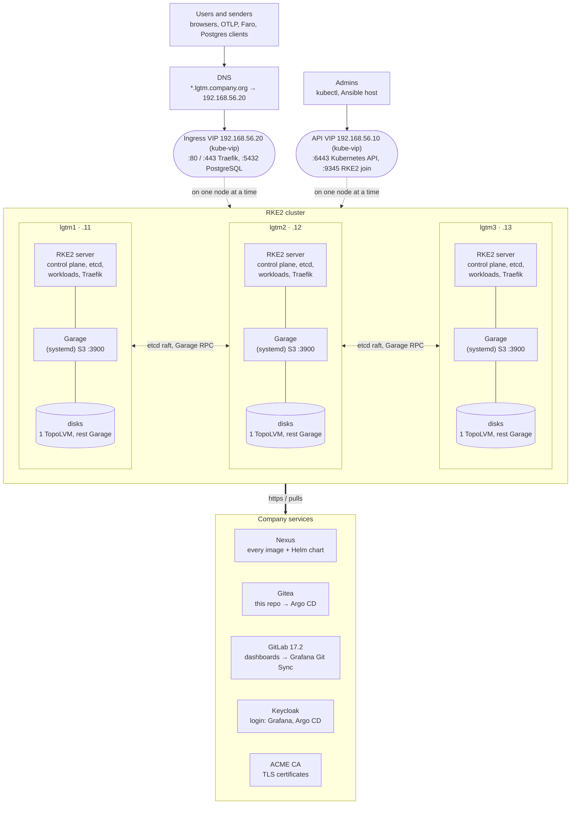
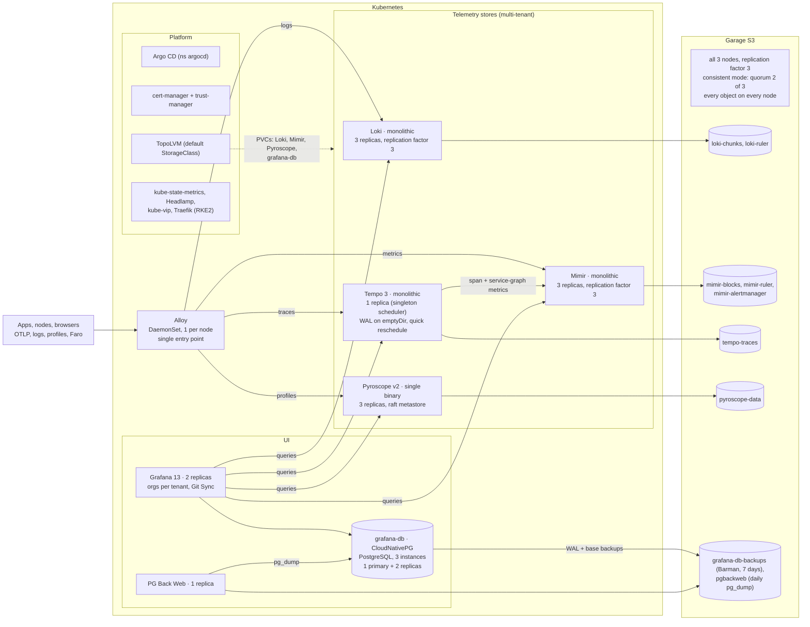

# Architecture

Two Mermaid diagrams: the servers and the network around them, then the applications on top. The addresses
are the lab's (`lab/inventory`); a real site sets its own in its inventory (`inventories/example`).

## Servers, network, company services

Three identical servers. Each one is an RKE2 server (control plane, etcd and workloads together), a Garage
node and a TopoLVM node. Two floating IPs (kube-vip, ARP) move to a surviving server when one fails: one for
the Kubernetes API, one for every LGTM hostname.

| What | Where | Fails over by |
|---|---|---|
| Kubernetes API | API VIP `vip` | kube-vip moves the IP; etcd keeps quorum with 2 of 3 |
| All LGTM hostnames (`<name>.<domain>`) | Ingress VIP `ingress_vip` | kube-vip moves the IP to another node's Traefik |
| Object storage | Garage on every node, Service `garage.lgtm.svc:3900` | node taken out of the Service while its Garage is down |
| Block storage (PVCs) | TopoLVM, one local disk per node | not replicated: the applications replicate themselves |

## Applications and storage

Everything except Garage runs in Kubernetes, deployed by Argo CD. "Monolithic" means one binary that runs all
components (`-target=all`); the replicas form a ring (Loki, Mimir) or a raft group (Pyroscope) and replicate
the recent data among themselves. Long-term data goes to Garage.

| Component | Mode | Replicas | Redundancy | Storage |
|---|---|---|---|---|
| Garage | systemd service on every node | 3 | replication factor 3, consistent mode | its own disks on each node |
| Loki | monolithic (`deploymentMode: Monolithic`) | 3 | replication factor 3 | TopoLVM PVC 2 Gi + S3 |
| Mimir | monolithic (`-target=all`, NGDATA chart) | 3 | replication factor 3 | TopoLVM PVC 2 Gi + S3 |
| Tempo 3 | monolithic (`-target=all`) | 1 | rescheduled within ~1 min; data in S3 | emptyDir + S3 |
| Pyroscope v2 | single binary (`-target=all`) | 3 | raft metastore (quorum 2 of 3) | TopoLVM PVC 2 Gi + S3 |
| Grafana | — | 2 | state in PostgreSQL | none |
| grafana-db | CloudNativePG | 3 | streaming replication, automatic failover | TopoLVM PVC 1 Gi; backups in S3 |
| Alloy | DaemonSet | 1 per node | every node sends its own data | none |
| PG Back Web | — | 1 | schedules the backups itself, so one only | none (S3) |
